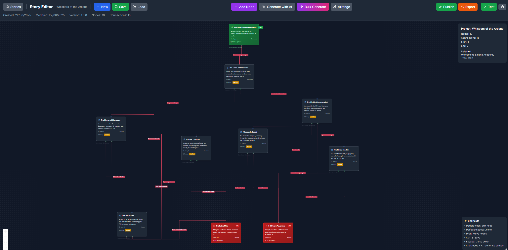

# NarrativeForge

NarrativeForge is a prototype for authoring and playing branching interactive
stories. It combines a visual graph editor with a story reader and optional
OpenAI-assisted content generation.



## What it demonstrates

- Modelling branching narratives as typed nodes, edges and choices.
- Editing Start, Story and End nodes through a React Flow interface.
- Validating graph connectivity and references before testing or export.
- Saving projects and reading progress in browser `localStorage`.
- Importing and exporting browser-local stories as JSON.
- Implementing export adapters for NarrativeForge JSON, generic JSON and
  Twine/Twee formats.
- Generating individual scenes or a draft story graph through server-side
  OpenAI API routes.
- Testing React components and story utilities with Jest and Testing Library.

The repository is a portfolio prototype, not a hosted multi-user service.
Projects remain in the current browser, and AI generation requires the user to
provide an OpenAI API key locally.

## Architecture

```text
Browser
├── Story editor
│   ├── React Flow nodes and edges
│   ├── graph validation and conversion
│   └── local project persistence
├── Story reader
│   └── saved reading progress
└── Next.js API routes
    ├── POST /api/ai/generate-story
    └── POST /api/ai/generate-bulk-story
             │
             └── OpenAI gpt-4o-mini
```

The editor owns the graph state. `GraphToStoryConverter` validates and converts
that graph into the format consumed by the reader and export adapters. AI
requests pass through Next.js route handlers so the API key is not sent to the
browser.

## Technology

| Area | Implementation |
| --- | --- |
| Application | Next.js 14, React 18, TypeScript |
| Visual editor | React Flow |
| State | Zustand and React state |
| Persistence | Browser localStorage |
| Assisted generation | OpenAI `gpt-4o-mini` through Next.js API routes |
| Styling and motion | Tailwind CSS, Framer Motion |
| Testing | Jest, Testing Library, Playwright configuration |

## Run locally

Requirements: Node.js 18.17 or later, npm 9 or later, and an OpenAI API key for
the assisted-generation features.

```bash
git clone https://github.com/NathanKneT/NarrativeForge-nextjs.git
cd NarrativeForge-nextjs
npm ci
```

Create `.env.local`:

```bash
OPENAI_API_KEY=your_key_here
```

Start the development server:

```bash
npm run dev
```

Open:

- `http://localhost:3000/` for the story library and reader.
- `http://localhost:3000/editor` for the visual editor.

The reader and editor work locally. Only AI-assisted generation requires an
OpenAI API key.

## Validation

```bash
npm run type-check
npm run lint
npm test
npm run build
```

The repository contains unit and component tests plus an end-to-end test
specification. Their presence is not presented as a coverage guarantee.

## Current boundaries

- Persistence is browser-local; there is no shared database or account system.
- Collaboration, permissions and project sharing are not implemented.
- AI routes do not currently include production rate limiting or usage quotas.
- Accessibility and production security still require a dedicated review.
- No public hosted demo is maintained.

These boundaries are intentional in the public description: the project is an
exploration of visual story modelling and assisted authoring, rather than a
production SaaS claim.

## Possible next steps

- Add authenticated server-side persistence and project ownership.
- Add rate limiting, schema validation and usage controls to AI routes.
- Complete the Playwright workflow for critical editor-to-reader journeys.
- Run and document an accessibility audit.
- Add story version history and collaborative editing only after server-side
  persistence exists.

## Author

[Nathan Rihet](https://github.com/NathanKneT) ·
[Portfolio](https://nathanglhf.com/) ·
[LinkedIn](https://www.linkedin.com/in/nathan-rihet/)
